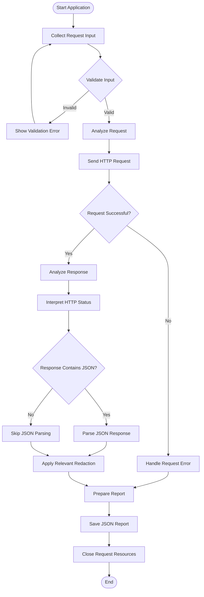

# HTTP Request Analyzer — Workflow

## 1. End-to-End Processing Flow

## 2. Workflow Explanation

1. **Start Application:** Execution begins in `main.py`.
2. **Collect Request Input:** The CLI handler collects the request details.
3. **Validate Input:** The application checks the supplied URL, HTTP method, headers, timeout, and JSON input where applicable.
4. **Analyze Request:** The request analyzer prepares request-analysis information.
5. **Send HTTP Request:** The request sender attempts to communicate with the target server.
6. **Handle the Result:** A received HTTP response proceeds to response analysis. A request exception follows the relevant error-handling path.
7. **Analyze Response:** Response metadata is examined when a response is available.
8. **Interpret HTTP Status:** The status interpreter provides an interpretation of the HTTP status code.
9. **Parse JSON When Applicable:** The JSON parser processes supported JSON responses.
10. **Apply Relevant Redaction:** Sensitive information is redacted where the application integrates the security utilities.
11. **Prepare and Save Report:** The report generator creates and saves a JSON report.
12. **Close Resources:** The application closes request resources when required.

## 3. Important Notes

- An HTTP status such as `404` or `500` is still an HTTP response; it is not automatically a connection failure.
- Network errors and timeouts may occur before a response is received.
- JSON parsing is only applicable when the response content can be processed as JSON.
- Redaction reduces exposure risk but does not guarantee complete secret detection.
- The exact branches and execution order must match the implementation in `main.py`; update this diagram if the code changes.

## 4. Related Documentation

- [Architecture](architecture.md)
- [Project README](../README.md)
